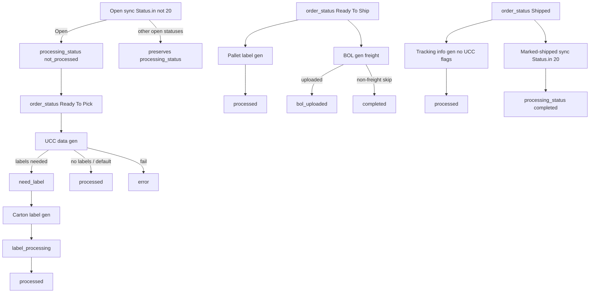

## TESTS FOR CRON JOBS

```
cd /home/ubuntu/logiwa_flask_app/labeling_process
/home/ubuntu/venv/bin/python -m unittest discover -s tests -p "test_*.py" -v
```
## MYSQL 

# logiwa workflow process (labeling):
mysql -u scott@jlab.com -p -h ec2-34-233-56-129.compute-1.amazonaws.com -D logiwa_workflow_process
p: N^9$J7Qc6emgSaUw

# goodyear website:
mysql -u scott@jlab.com -p -h ec2-34-233-56-129.compute-1.amazonaws.com -D logiwa_reporting
p: N^9$J7Qc6emgSaUw

## ACTIVE CRON JOBS
*/3 * * * * /home/ubuntu/venv/bin/python /home/ubuntu/logiwa_flask_app/labeling_process/logiwa_b2b_workflow_database_update.py **
*/20 * * * * /home/ubuntu/venv/bin/python /home/ubuntu/logiwa_flask_app/labeling_process/logiwa_b2b_workflow_database_marked_shipped.py
*/2 * * * * /home/ubuntu/venv/bin/python /home/ubuntu/logiwa_flask_app/labeling_process/logiwa_ucc_data_generator_new.py
*/3 * * * * /home/ubuntu/venv/bin/python /home/ubuntu/logiwa_flask_app/labeling_process/logiwa_ucc_pallet_label_generator_new.py
*/5 * * * * /home/ubuntu/venv/bin/python /home/ubuntu/logiwa_flask_app/labeling_process/logiwa_ucc_carton_label_generator_new.py
2,14,32,47 * * * * /home/ubuntu/venv/bin/python /home/ubuntu/logiwa_flask_app/labeling_process/logiwa_tracking_info_generator_new.py
*/15 * * * * /home/ubuntu/venv/bin/python /home/ubuntu/logiwa_flask_app/labeling_process/bol_generator_new.py
*/6 * * * * /home/ubuntu/venv/bin/python /home/ubuntu/logiwa_flask_app/labeling_process/logiwa_label_processing_error_handling_new.py
10,25,40,55 * * * * /home/ubuntu/venv/bin/python /home/ubuntu/logiwa_flask_app/logiwa_netsuite_package_creation.py
5 * * * * /home/ubuntu/venv/bin/python /home/ubuntu/logiwa_flask_app/logiwa_netsuite_package_creation_production.py
# Daily table uploads for data and label requriements and daily logiwa token request
1 7 * * * /home/ubuntu/venv/bin/python /home/ubuntu/logiwa_flask_app/daily_refresh/daily_table_upload_customer_defaults.py
2 7 * * * /home/ubuntu/venv/bin/python /home/ubuntu/logiwa_flask_app/daily_refresh/daily_table_upload_item_master_defaults.py
3 7 * * * /home/ubuntu/venv/bin/python /home/ubuntu/logiwa_flask_app/daily_refresh/logiwa_token_refresh.py
4 7 * * * /home/ubuntu/venv/bin/python /home/ubuntu/logiwa_flask_app/daily_refresh/netsuite_tariff_categories.py
5 7 * * * /home/ubuntu/venv/bin/python /home/ubuntu/logiwa_flask_app/daily_refresh/inbound_shipments_date_refresh.py
8 7 * * * /home/ubuntu/venv/bin/python /home/ubuntu/logiwa_flask_app/goodyear_website/scripts/open_purchase_orders_db_update.py
9 7 * * * /home/ubuntu/venv/bin/python /home/ubuntu/logiwa_flask_app/daily_refresh/retailer_upload.py


Pallet label

labels with vendor specific details


walmart needs specifici nformation
- same with other destinations

sscc

Priority:
We need to make sure that all labels receive the relevant information needed to build that label, if any data is missing or misaligned (the data does not fit the format needed, or the data is incorrect), we need to have a way to fix this data. This means that ideally there is a database row correlated with this data

flow:
1. List of shipment orders and their current status, should show some visibility if there are current errors
2. -> List of line items, line item table
	1. If we need to re-run logiwa_ucc_data_generator_new, then we should delete these line items and regenerate them
		1. deleted_at column? logged in events?
3. -> Labels, label table
	1. If we need to re-run logiwa_ucc_data_generator_new, then we should delete all labels and regenerate them.
		1. deleted_at column? logged in events?
4. Dashboard with logging metrics, # of failed jobs etc, grafana?
5. 

Add logs transport to grafana or prometheus or similar so that we can query for warnings/errors etc, then we can pull those up on the website. There will need to be a field on the transport for the id so it can be connected to the specific shipment order.

## TODO:
- Get repo access from scott
- Setup test database on EC2
- Run some tests on the EC2, doing it on local dev is just a pain
- 
- Dashboard with visibility into successful jobs
- add dashboard on logistics.jlab.com
- fix nav bar
- Create an events table for logging all events
	- Create an interface for interacting with this easily with just a function call and passing in a couple params
	- Add event logging for when warehouse workers make changes to the label data, should be able to recreate the original data
- Create logging transport so that logs are more visible and not just inside of a folder
	- Create an interface for interacting with this easily with just a function call and passing in a couple params
	- Log on failure
		- Log to Loki or log to mysql. Mysql would just be for fatal errors.
	- 

We probably want to store all labels within the database instead of it just being within the json file? Then we can have a status for that label that makes sure that it gets printed, each label its SSCC etc.

add error/warning table 

The B2B label pipeline is a cron-driven queue centered on MySQL table `open_shipment_orders` in `logiwa_workflow_process`. NetSuite does not talk to these scripts directly; it feeds Logiwa shipment orders and a synced `netsuite_item_master_info` table. The scripts read Logiwa + MySQL and write artifacts back to Logiwa (JSON UCC payload, PDF labels) and S3.

.env.database.logiwa_workflow_process

## Label Generation steps

Steps if generating label (determined by custom text fields of Carton Label Required and/or Pallet Label Required):
1. logiwa_b2b_workflow_database_update.py runs every 3 minutes
	1. Extract - Fetches orders from Logiwa that are in-progress/open status
	2. Transform - Adds data needed to create label and that carton_label_required and pallet-label_required and drops orders whose code starts with FOMS
	3. Load - open_shipment_orders table,
		1. **If order status is open**: refreshes/updates workflow fields from logiwa, and set processing_status to not_processed, clear flags and error messages. We have to keep refreshing on order status open until we get atleast "Ready to Pick" status to continue.
			1. Also allows us to wipe the work already done if we decide that this order needs to be reset. If an order dorps back to open after partial work, taht sync wipes pipeline progress on the MySQL row.
		2. Otherwise: upsert metadata only
	4. Failure handling — Empty API result, DB errors, or connection failure triggers a critical email to a fixed list (Scott, John, Ryan) via Outlook SMTP; avoids duplicate emails when one was already sent.
2. logiwa_ucc_data_generator_new.py runs every 3 minutes
	1. Responsible for fetching and transforming the data needed to generate the labels for each carton, all this data is stored within one json, which is a list of objects where each object is the data needed for one label.
	2. Exits if a cron_job is already running, it does this buy checking processing_status = 'label_processing'
	3. Selects data with the following columns set: order_status = 'Ready To Pick', either label toggles true, data_generated = FALSE
	4. Responsible for fetching the relevant data needed for generating labels
	5. Work selection — Loads up to two orders where:
		- `order_status = 'Ready To Ship'`
		- `pallet_label_required` is true
		- `pallet_label_generated` is false
		Also marked as label_processing
	6. Fetches ShipmentOrder data needed to create labels, and generates custom JSON based on the CustomerName since each customer will have a unique layout template for the label and which fields get encoded into barcodes.
		1. Each customer will also have their own customer-specific draw function that determines what gets printed and which GS1 elements are built. Each retailer path gets its own template + field set
		2. Barcodes are mostly GS1-128 but what's encoded changes
		3. Barcodes differ by customer and by data in the JSON, those differences are contained below: (add some sort of obsidian reference to the table here
	7. Build label data
		- Loads NetSuite item master: casepack, GTIN, UPC, weight ,internal IDs
		- For each line item, computes how many cartons (allocated qty / casepack or UOM ratio; DTC (direct-to-customer) gets special handling in generic_ucc_list)
		- One dict per carton: ship from/to, PO, BOL, carrier, SKU, buyer part #, SSCC, package index, etc
		- sscc_code maps to ucc_label
	8. In summary: we fetch data for a shipping order, we get a list of line items for that shipping order, we get all the information needed for that line item and compute how many cartons we need for that line item [[Labeling##**case pack **]]. Each carton will have its own SSCC and label, and we create json for each label based on customerName (shape differs by customer) and upload all those json objects as a list attached to the shipping order on logiwa. The name of the list of objects is ucc_label_list and is created in create_{CUSTOMER_NAME}\_ucc_list.
3. logiwa_ucc_carton_label_generator_new runs every 5 minutes (data generated TRUE)
	1. Responsible for turning UCC JSON into a printable carton label
	2. Generates a label for each object in ucc_label_list, with a custom label depending on the customerName
	3. 
4. logiwa_ucc_pallet_label_generator_new runs every 3 minutes
	1. Responsible for generating pallet labels based on 
5. bol_generator
	1. 

## Steps if not generating label 

Steps if not generating label (B2C, direct to customer) (determined by custom text fields of Carton Label Required and/or Pallet Label Required):
1. logiwa_b2b_workflow_database_update.py runs every 3 minutes
	1. Extract - Fetches orders from Logiwa that are in-progress/open status
	2. Transform - Adds data needed to create label and that carton_label_required and pallet-label_required and drops orders whose code starts with FOMS
	3. Load - open_shipment_orders table,
		1. **If order status is open**: refreshes/updates workflow fields from logiwa, and set processing_status to not_processed, clear flags and error messages. We have to keep refreshing on order status open until we get atleast "Ready to Pick" status to continue.
			1. Also allows us to wipe the work already done if we decide that this order needs to be reset. If an order dorps back to open after partial work, taht sync wipes pipeline progress on the MySQL row.
		2. Otherwise: upsert metadata only
	4. Failure handling — Empty API result, DB errors, or connection failure triggers a critical email to a fixed list (Scott, John, Ryan) via Outlook SMTP; avoids duplicate emails when one was already sent.
2.  b2b_workflow_database_marked_shipped
	1. If logiwa shipment order shows status 20, then we mark shipment order as shipped and completed
3. tracking_info_generator (triggered if shipment order is marked as shipped, both label flags false, and data_generated is false)
	1. shares flags with ucc_data_generated and is similar, this file uses the data_generated flag (== FALSE) to determine whether or not to generate the json required for netsuite_package_creation.
	2. Fetches the full shipment from Logiwa
	3. Builds a package list via generic_tracking_list — LPN as tracking number, SKU, NetSuite item id, weight, casepack, package index (no SSCC/UCC labels).
	4. Uploads that list to Logiwa as `{orderCode}_ucc_carton_netsuite_data_{timestamp}.json` (document type 6).
	5. Sets `processing_status = 'processed'` and `data_generated = TRUE`.
4. netsuite_package_creation
	1. Responsible for populating packages for Item Fulfillments in netsuite, Item Fulfillments are a NetSuite shipping record for what actually went out against a Sales Order. A sales order is a customer order in Netsuite (what was sold). A logiwa shipment order is just the warehouse execution of that same shipment.
	2. Asks NetSuite which IFs are missing packages (logiwa_if_needs_packages_script) [[#Netsuite Sales Order]]
	3. Loads the matching Logiwa shipment + its uplaoded *_ucc_*_netsuite_data_*.json 
	4. creates two kinds of NetSuite custom records:
		1. Packages (sps package fields): tracking, UCC/SSCC, weight, qty, carton index
		2. Package contents: which SKU/line/qty sits in each package.
	5. Verify counts, then uploads the package/content paylods back to Logiwa as a receipt trail.
		1. Uploads packages, then package contents (SKU to package linkage), in async chunks of 750
	6. Does not create the fulfillment itself - it fills in the package structure that fulfillment is missing.
	7. Verifies totals with another NetSuite restlet, then writes audit JSON back to Logiwa


## Shipment order workflow (for orders both requiring and not requiring labels)

![[Pasted image 20260803155921.png]]

## Netsuite Sales Order

Sales order, tem Fulfillment (IF) and package visual (Netsuite info)

![[Pasted image 20260803163805.png]]

## SSCC

|Pattern (examples in code)|Typical use|
|---|---|
|SSCC (`data_dict['sscc']`)|Carton or pallet ID — value from JSON (carton) or LP after assignment (pallet)|
|(420) + ship-to ZIP|Postal code on many retailers|
|(90) + vendor_id|Walgreens-style vendor|
|(91) + ship_to_code|Walgreens-style “For” / destination|

## **case pack:

- The shipping case that will be used for the cartons in a shipping order.
- This is sku level, we loop through line items and determine the amount of cartons needed for each line item and we use data for that sku's case_pack for this calculation.


## Processing_status description

`processing_status` is updated by those scripts as they run, for example:

- `'need_label'` — UCC JSON uploaded, carton/pallet work pending
- `'label_processing'` — a generator holds a lock (only one at a time globally in several scripts)
- `'processed'` — step finished successfully
- `'error'` — failure; may also get reset by error handler if stuck in `label_processing` > 15 minutes

The repo does not define a full enum mapping (numeric ID → name) in one place. What you can infer:

## Order_status description

| Role in code                  | Typical name(s) in scripts | Notes                                                                                                               |
| ----------------------------- | -------------------------- | ------------------------------------------------------------------------------------------------------------------- |
| Sync “open pipeline”          | Many statuses              | This script pulls status IDs `2,4,6,…,18` and stores whatever name Logiwa returns.                                  |
| Reset automation              | `Open`                     | Only when name is `'Open'` does the DB update reset flags and set `processing_status = 'not_processed'`.            |
| Start UCC data                | `Ready To Pick`            | Used in `logiwa_ucc_data_generator_new.py`, NetSuite package sync, etc.                                             |
| Pallet / BOL stage            | `Ready To Ship`            | Pallet generator, BOL generator.                                                                                    |
| Post-ship tracking JSON       | `Shipped`                  | Tracking generator when no carton/pallet labels.                                                                    |
| Shipped sync (sibling script) | Status ID `20`             | `logiwa_b2b_workflow_database_marked_shipped.py` uses `Status.in=20` (“Marked as Shipped”) for a date-bounded sync. |

Spelling caveat: Webhooks compare `'Ready to Pick'` / `'Ready to Ship'` (lowercase “to”), while several cron queries use `'Ready To Pick'` / `'Ready To Ship'` (capital “To”). The DB stores whatever Logiwa returns on the list API; if those strings ever differ, cron vs webhook could disagree. Worth verifying against live Logiwa data for one order.


## Terms (pallet-label context)

| Term                | Meaning                                                                                                                                       |
| ------------------- | --------------------------------------------------------------------------------------------------------------------------------------------- |
| UCC carton row      | One entry in the attached JSON list = one planned carton (SKU, PO, addresses, weight, etc.).                                                  |
| Warehouse case pack | One physical case the warehouse loaded, derived from pick/load history (SKU + qty on an LP).                                                  |
| SSCC                | Serial Shipping Container Code — the barcode ID on the label (GS1). On cartons, often from JSON; on pallets, usually the LP after assignment. |
| LP                  | License plate — Logiwa’s ID for a case or pallet container; becomes the pallet’s SSCC on the label.                                           |
| PRO                 | Progressive Routing Order — carrier freight tracking/reference number; copied from the shipment order onto the label.                         |

## Anatomy of the SSCC

With the actual values from the data generator, a code is 20 characters:

|Segment|Value|Digits|
|---|---|---|
|Application Identifier|`00`|2|
|Extension digit|`1`|1|
|GS1 company prefix|`087837600`|9|
|Serial reference|counter, `zfill(7)`|7|
|Mod-10 check digit|computed|1|

The validator in `generate_sscc` enforces extension + prefix + serial = exactly 17, then appends the check digit for a proper SSCC-18. The `00` is the AI, not part of the SSCC.

## How a carton gets its SSCC

The generator reads the highest serial ever issued out of the `ucc_labels` table, strips off the AI, extension, prefix, and check digit to recover the bare counter, then increments it once per carton as it walks the line items. Every issued code is written back to `ucc_labels` with the company and a timestamp, which is what enforces the no-reuse-for-two-years rule. So carton SSCCs are minted by your code, from your GS1 prefix, against a database counter.

## Where SSCC is correlated to line items(skus)

For each carton you create two rows in NetSuite:

1. A package row: "here's a box, its SSCC is ...4529, it weighs 3.2 lbs."
2. A content row: "that box holds 12 units of SKU-A, from line 3 of this fulfillment."

So 240 cartons means 240 package rows and at least 240 content rows. Every SSCC is spelled out explicitly.

The reason it's per carton rather than per line item is that the retailer scans one box at a time at the door. They scan SSCC ...4529 and need an exact answer for _that_ box. A "SKU-A starts at 
...4500" range wouldn't tell them anything about the box in their hands.


TODO:
- Map out at which stage errors should be detected and what should be changed
- 

## Fix the following errors:
1. case pack having an issue where it can be missing from netsuite_item_master, in order to test this we can delete the casepack information from the json file on an old order, set carton_label_generated to 0 so that it re-runs the label generation script, capture that error and see how we can make sure this error is shown to the user so that it can be fixed by the user.

Solution:
`uomRatio > 1` is the bypass that lets `casepack = 0` through to the UCC JSON and a successful `ucc_document` event — as long as nothing else fails and Logiwa returns OK.

if casepack is ever 0 or null (0), then raise an error for that shipment order and have UX for entering the casepack number.


carton_label_generated to 0
delete case pack from the 

2. Information missing from Logiwa Order, in a previous error there was no customer name provided by walmart or something. If there's missing information then we raise a flag and say this is missing and needs to be filled in, then re-generate the label after the information is provided to the label. 

Do tests on the following order:
https://logistics.jlab.com/shipment-orders/c75e2d45-f56f-43ab-86ba-ee643d0aa4c0

Fact tables with


How to test:
Add a fake sku into netsuite_item_master and a fake shipment order with fake flags set so that I can get logiwa_ucc_data_generator_new and test when casepack is 0.

error code for invalid casepack: "error_message"
INVALID_CASEPACK

**nuance:**
If there is 

TODO AFTER LUNCH:
1. read through ai response for understanding
2. respond to michael's email


maybe related:

https://logistics.jlab.com/shipment-orders/310ef3a2-f2b0-4382-bed1-d5b8d88a4e21
+ {'success': False, 'message': 'Fields do not match. Total packages loaded to Netsuite were: 145 Expected packages from Logiwa was 2.'}


If there's no data then add a custom error that there's no data because the file's too big and we can't upload it to Logiwa because of that.

add a checkbox for hiding resolve/unresole audit messages, these can spam the events table. Should be checked by default.

Editing netsuite item master should go to the item master table, then also send an email to the relevant parties.

# Plan:

FIRST:
Add visibility to Scott's version of labels / duct-tape fixes to reduce errors or at least provide a way to fix errors when they arrive
1. Add an events or errors/logging table within the mysql database that correlates to the shipping order ID, we want to be able to flag where in the process things went wrong
	1. Have an events table that correlates the shipping order ID with the json of the failed label, so have a json column where we can store unique data for visibility into the error, in the case of a failed label you would just include the json for the label. 
2. Add a table within the website that shows shipping orders that aren't completed, how long that shipping order has been there, if there are any errors correlated with that shipping order, etc.


Events table:
id: incr()
entity_id: fk references shipping_order (for now , in future if we add tables and entity_type we would remove the reference)
time_stamp: current_timestamp
changes: json
event_handle: varchar(100)


Update styling of shipment orders page
List of shipment orders
- ~~Info for that shipment order and current status etc
	- ~~add open order statistics that mimic the functionality in playground~~
		- ~~Orders by retailer~~
		- ~~Orders by order type~~
		- ~~Orders by order status~~
- ~~Netsuite Info~~
- ~~Logiwa Info~~
- ~~Line items~~
- ~~Events~~
	- if netsuite info is edited, logiwa info, or a line item, etc, anything, then we add an event and we also need to include the user_id of the person logging that
		- add user_id to events table


add event logging to labels
- implement workflow sync event logging (phase1) -> build, don't do at the end of the day today incase we blow something up it doesn't cause any issues 

For future:

There should be a retailer table
- need some way of specifying the fields necessary for this, json?


tie ucc labels to the identifier of the line item, so that we can list out the ucc labels for each line item

add events for cron jobs, successful run or running failure etc, so we have logs for a cron event_type and the event_id is the name of the cron job.


TODO
- Plan out top down rewrite, how should data be pulled, what data should live within our database and what data should just live within the original source of truth.
	- OOP or data driven programming?
	- Rewrite must still be in python, use Pydantic
- ~~Include JSON in data generation~~
- ~~Add stats for cron jobs, successful run count, error count, etc. Need visibility into the Events table and its contents.~~
	- ~~Aggregate into Prometheus~~
	- ~~Show on grafana~~
	- ~~Plan is inside of agent tab "Cron job stats integration"~~
	- ~~Just need to add the CRON_METRICS_HANDOFF.md over to playground so that it can create the grafana pages~~
- ~~Pipe standard output of all the cronjobs to a file~~ 
- ~~add event_source column to table and reflect that in the dashboard for better visibility into what cron-job~~ 
- Complete edit pages for goodyear website on shipment order information
	- When logiwa is updated, then the labeling process should probably reset? This is already possible by reseting the status to Open? Look into this and figure out a best aproach
	- EDITS SHOULD ALSO BE WIRED INTO EVENTS SO WE CAN SEE WHAT USER EDITED WHAT. **IMPORTANT**
		- add user_id column to database, nullable
- Data aware retry buttons with optional retry buttons that give you access to a level of granularity that lets you decide where in the labeling process you get reset
	- optionally just full reset like the homepage tools do.
- ~~event level visibility, we should see if there are any errors for an event.~~
- \[optional] add ignore error options for both events and processing_status 
- ~~Change status filter to be a mutli-select so that you can filter by multiple at once and not others.~~
- ~~Add a global search bar for being able to search for any shipment-order, not just the active ones, when you type something in the results should pop up under the search bar and over other things on the screen.~~
	- ~~Better filtering so that we have the option of not only showing non-completed orders, we could also show like all orders within a certain time frame?~~
- ~~Cron-run event type probably shouldn't exist, ai added this, probably get rid of this~~
	- ~~Solution: Cron job for deleting cron_run event type older than 14 days~~ 
- update "Latest run by job" to be more visually appealing
- ~~Display cron job health on shipment orders page~~
- Provide access to the carton/pallet retries that live int he homepage tools to the order detail page.

Process for an errored label: Go into the shipment-orders page 


- `logiwa_b2b_workflow_database_update.py`
- `logiwa_b2b_workflow_database_marked_shipped.py`
- `logiwa_ucc_data_generator_new.py`
- `logiwa_ucc_pallet_label_generator_new.py`
- `logiwa_ucc_carton_label_generator_new.py`
- `logiwa_tracking_info_generator_new.py`
- `bol_generator_new.py`
- `logiwa_label_processing_error_handling_new.py`
	- rows with `processing_status = 'label_processing'` whose `last_updated` is older than 15 minutes get marked `error`.
- `logiwa_netsuite_package_creation.py`
	- This file was deleted and replaced with below
- `logiwa_netsuite_package_creation_production.py`
	- Uses a Netsuite RESTlet to run a saved search for item fulfillments that still need packages. The RESTlet is a custom SuiteScript that runs in NetSuite when called.
	- Pulls context from NetSuite (line items) and Logiwa (shipment order, PRO/tracking, carton vs pallet flag)
	- Reads UCC package JSON already attached on the Logiwa order (`*_ucc_carton_netsuite_data_*`, `*_ucc_pallet_netsuite_data_*`, or `*_ucc_netsuite_data_*`) — produced earlier by the label/tracking generators.
	- Builds NetSuite package records (SSCC, tracking, weight, qty), either:
	    - Carton-level when `customFieldToggle1` is true, or
	    - Pallet-level (aggregated by SSCC from `shipmentInfo`) when false / freight+CVS.
	- Uploads packages, then package contents (SKU ↔ package linkage), in async chunks of 750.
	- Verifies totals with another NetSuite restlet, then writes audit JSON back to Logiwa (`*_package_*` / `*_package_content_*`).

broader TO DO:
1. Labeling Project
2. Foms-React project
3. Dev environment for playground
4. Data warehouse project, central location for all company data.
5. A/B testing, standardized and where data should flow for this.
6. Create a document that highlights the significant portions of the DW/BI system, what the deliverables are, what the rules are for those sections, etc.
7. 

![[Pasted image 20260804084610.png]]
## Pipeline flow (status transitions)




Shopify orders get pushed straight into logiwa shipment orders and at then generates an invoice after shipping.

Northland


## Event Event Table

event_id INT PRIMARY KEY,
status ENUM('ignored','resolved) NOT NULL,
user_id INT NOT NULL,
note TEXT NULL,
created_at CURRENT_TIMESTAMP,
updated_at CURRENT_TIMESTAMP


cascade event event if event is deleted.


Finish the netsuite item master flow of editing and uploading. The error stays on the page even after pushing an update.


https://logistics.jlab.com/shipment-orders/4e19cc2e-a363-4776-8399-b07f59e05486
Database error: 1038 (HY001): Out of sort memory, consider increasing server sort buffer size


The labeling pipeline map display under order detail could be updated so that the map is under like constant values or a map, maybe a json file. Maybe a read only json file that contains these data structures. One is a map where the key is a tuple with each of the flags that determines its specific pipeline, where. the value is the pipeline name. Another is a map where the key is the pipeline name and the value is an array with each of the steps, in order. Another is a map where the keys are the steps and the value is an object of key value pairs that contains the needed data for that step like id (maybe not? this is the key), source, label, done, gate, state.


```
SELECT e.id, e.event_type, e.entity_id, e.event_handle, e.event_source, e.changes, e.created_at,

a.status AS acknowledgement_status,

a.user_id AS acknowledgement_user_id,

a.updated_at AS acknowledgement_updated_at

FROM events e

LEFT JOIN event_acknowledgements a ON a.event_id = e.id

WHERE e.entity_id = %s

ORDER BY e.created_at DESC
```