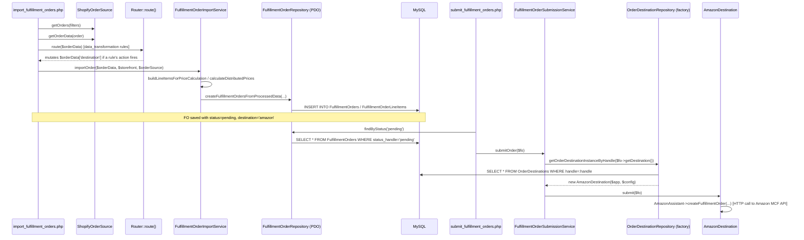

Now I have the full picture. Let me walk you through this in four parts: the call stack, the DI pattern, PDO, then your concrete scenario.

## Part 1: The "stack trace" — source to destination

Here's the actual call chain, annotated with what's injected where. This spans two separate cron scripts (they run independently, hours apart) plus one shared entity in between.



Concretely, with file:line references:

1. **`ecomm/cron/foms/import_fulfillment_orders.php`** loads the storefront's orders and, per order, calls the router then the import service.

```150:237:ecomm/cron/foms/import_fulfillment_orders.php
            $orders = $orderSource->getOrders($filters);
        ...
            $orderData = $orderSource->getOrderData($order);
            $orderData['source_storefront'] = $source_storefront;
        ...
            $result = $fulfillmentOrderImportService->importOrder($orderData, $storefront, $orderSource, [
                'dryRun' => $dryRun,
                'router' => $routers['data_transformation'],
                'inventoryAssistant' => $IA,
                'source_storefront' => $source_storefront,
                'existingFulfillmentOrdersForOrder' => $existingFulfillmentOrdersForOrder,
            ]);
```

2. Inside **`FulfillmentOrderImportService::importOrder()`**, the router runs against the raw `$orderData` array *before* line items/prices are built, and can mutate `destination`:

```59:97:vendor/joeybab3/foms/src/FulfillmentOrder/FulfillmentOrderImportService.php
        // Paid total
        $paid_total = $this->resolvePaidTotal($orderData, $storefrontConfig);
        $orderData['paid_total'] = $paid_total;
        ...
        if (!empty($orderData['send_to_netsuite']) && $orderData['send_to_netsuite'] === true) {
            $this->app->log("  [Order " . ($orderData['id'] ?? '') . " - " . ($orderData['order_number'] ?? '') . " - send_to_netsuite is true, routing to NetSuite]");
            $orderData['required_destination'] = 'netsuite_logiwa';
            $orderData['destination'] = 'netsuite_logiwa';
        }

        // Routing
        $executed_actions = [];
        if ($router !== null && $router->isEnabled()) {
            $executed_actions = $router->route($orderData);
            ...
        }
        ...
        $order_destination = $orderData['destination'] ?? $defaultDestination;
```

This `send_to_netsuite` block is your best template — it's exactly "compute something, then override `destination`" — I'll reuse this pattern below.

3. The order gets persisted to MySQL via `FulfillmentOrderRepository` (PDO) with `destination = 'amazon'` (or whatever value ended up in `$orderData['destination']`).

4. **Hours later**, a *separate process* — `ecomm/cron/foms/submit_fulfillment_orders.php` — picks up all `pending` rows and calls `FulfillmentOrderSubmissionService::submitOrder($fo)`, which does:

```40:58:vendor/joeybab3/foms/src/FulfillmentOrder/FulfillmentOrderSubmissionService.php
        $orderDestination = $fo->getDestinationInstance();
        ...
        $orderSource = $fo->getSourceInstance();
        ...
            try {
                $orderDestination->submit($fo);
```

5. `$fo->getDestinationInstance()` is where the string `destination` column gets turned back into a live object:

```78:83:vendor/joeybab3/foms/src/FulfillmentOrder/FulfillmentOrder.php
    public function getDestinationInstance(): OrderDestinationInterface
    {
        $orderDestinationRepository = $this->app->getDependency('orderDestinationRepository');

        return $orderDestinationRepository->getOrderDestinationInstanceByHandle($this->destination);
    }
```

6. That repository is a hand-written factory — a `switch` on the destination's `type` column:

```234:268:vendor/joeybab3/foms/src/OrderDestination/OrderDestinationRepository.php
    public function getOrderDestinationInstanceByHandle(string $handle): OrderDestination
    {
        if(isset($this->orderDestinations[$handle])) {
            return $this->orderDestinations[$handle];
        }

        $orderDestination = $this->findByHandle($handle);
        ...
        $type = $orderDestination->getType();
        $config = $orderDestination->getConfig();

        try {
            switch ($type) {
                case 'shopify':
                    $instantiatedOrderDestination = new ShopifyDestination($this->app, $config);
                    break;
                case 'amazon':
                    $instantiatedOrderDestination = new AmazonDestination($this->app, $config);
                    break;
```

7. Finally, `AmazonDestination::submit()` builds the MCF payload and calls out to Amazon:

```102:173:vendor/joeybab3/foms/src/OrderDestination/AmazonDestination.php
    public function submit(FulfillmentOrder &$fulfillmentOrder): void
    {
        ...
        $mcf_order = $this->AA->createFulfillmentOrder($mcf_order_id, $order_name, $shippingInfo, $lineItems, $mapped_shipping_speed, $block_amzl, $blank_box, $channel_name);
```

**Key takeaway:** the "destination" is just a **string column** (`FulfillmentOrders.destination`, e.g. `'amazon'`) until the moment it's needed, at which point a factory (`getOrderDestinationInstanceByHandle`) reads config from the `OrderDestinations` table and instantiates the right class. This decoupling is exactly what makes your use case tractable — to reroute an order, you just need to change that string before it's persisted (or before it's submitted).

## Part 2: How dependency injection actually works here

There is **no DI framework** (no autowiring, no `#[Inject]` attributes, no container.yaml). It's a hand-rolled pattern, two flavors:

**Flavor A — the `App` service locator.** `App::setupDependencies()` (called once, from the constructor) manually `new`s every repository/service and stashes it in an array keyed by string:

```178:213:vendor/joeybab3/foms/src/App.php
    private function setupDependencies(): void
    {
        if (isset($this->config['database'])) {
            $this->dependencies['pdo'] = $this->createPdoDependency($this->config['database']);
            $this->dependencies['fulfillmentOrderLineItemsRepository'] = new FulfillmentOrder\FulfillmentOrderLineItemsRepository($this);
            $this->dependencies['fulfillmentOrderRepository'] = new FulfillmentOrder\FulfillmentOrderRepository($this);
            ...
            $this->dependencies['fulfillmentOrderImportService'] = new FulfillmentOrder\FulfillmentOrderImportService($this);
```

Notice every repository/service constructor takes `$this` (the `App` instance) — that's the *only* thing ever injected at this layer. Each class then pulls whatever else it needs out of `$app->getDependency('...')` lazily, on demand, rather than declaring its dependencies up front in the constructor signature. That's why you see this pattern constantly:

```115:120:vendor/joeybab3/foms/src/OrderDestination/AmazonDestination.php
        $lineItemsRepository = $this->app->getDependency("fulfillmentOrderLineItemsRepository");
        $lineItems = $lineItemsRepository->findByFulfillmentOrderId($fulfillmentOrder->getId());

        $shippingInfoRepository = $this->app->getDependency("shippingInfoRepository");
```

Pros: cheap to wire up, no config files. Cons (per the audit): you can't easily unit test a class in isolation without a full `App`, and there's no compile-time guarantee a dependency exists — `getDependency()` throws at runtime (`getDependency()` at `App.php:75-78`) if you typo a key.

**Flavor B — manual factories for pluggable types.** `OrderSource` and `OrderDestination` implementations aren't in the static dependency list (there could be N of them, configured in the DB), so they're built on-demand by a `switch`-based factory (`OrderDestinationRepository::getOrderDestinationInstanceByHandle`, shown above) that reads a `type` column and does `new AmazonDestination($app, $config)`. Every constructor still takes `$app` so the object can reach back into the container for anything else it needs.

So "dependency injection" here really means: **constructor-inject `$app`, then pull specifics lazily via string keys.** There's no interface-based auto-wiring — if you add a new class that needs a new dependency, you either add it to `App::setupDependencies()` (if it's a singleton-ish service) or `new` it directly with `$app` passed in (if it's created ad hoc, like destinations/sources).

## Part 3: PDO — the database layer

PDO ("PHP Data Objects") is PHP's built-in, driver-agnostic SQL API — think of it like a thin `Connection`/`PreparedStatement` API, similar to JDBC. FOMS creates exactly **one PDO connection per `App` instance**, at startup:

```220:237:vendor/joeybab3/foms/src/App.php
    private function createPdoDependency(array $dbConfig): PDO
    {
        $charset = 'utf8mb4';
        $dsn = "mysql:host=127.0.0.1;dbname={$dbConfig['db']};charset=$charset";
        
        $options = [
            PDO::ATTR_ERRMODE => PDO::ERRMODE_EXCEPTION,
            PDO::ATTR_DEFAULT_FETCH_MODE => PDO::FETCH_ASSOC,
            PDO::ATTR_PERSISTENT => true  // This ensures connection reuse
        ];

        return new PDO($dsn, $dbConfig['username'], $dbConfig['password'], $options);
    }
```

Three important options here:
- `ERRMODE_EXCEPTION` — a failed query throws `PDOException` instead of returning `false` silently (good; means you don't have to check every call).
- `FETCH_ASSOC` — `fetch()` returns `['column_name' => value, ...]` associative arrays by default, rather than numeric-indexed or object results.
- `ATTR_PERSISTENT` — reuses a TCP connection to MySQL across requests handled by the same PHP-FPM worker (avoids reconnect overhead), at the cost of some connection-state footguns (not relevant to you here).

Every repository grabs this *same* PDO object out of the container (`$this->pdo = $app->getDependency('pdo');` — see `FulfillmentOrderRepository.php:52`) rather than opening its own connection.

The actual query pattern everywhere is **prepared statements with named placeholders**, which is what protects against SQL injection — you never concatenate user data into SQL strings:

```191:216:vendor/joeybab3/foms/src/OrderDestination/OrderDestinationRepository.php
    public function update(OrderDestination $orderDestination): int
    {
        $stmt = $this->pdo->prepare("
            UPDATE OrderDestinations
            SET handle = :handle,
                type = :type,
                ...
            WHERE id = :id
        ");
        $stmt->execute([
            ':id' => $orderDestination->getId(),
            ':handle' => $orderDestination->getHandle(),
            ':type' => $orderDestination->getType(),
            ...
        ]);

        return $orderDestination->getId();
    }
```

Reading this: `prepare()` sends the SQL template to MySQL (or caches it) with `:placeholders`; `execute([...])` binds actual values and runs it — MySQL never sees your values as "SQL text," so a malicious `handle` like `'; DROP TABLE...` is just treated as a literal string. `SELECT`s follow the same shape, then you call `->fetch()` (one row) or `->fetchAll()` (all rows), returning associative arrays because of `FETCH_ASSOC`, e.g. `findByHandle()` a few lines above `update()` in that same file. Repositories then take that raw array and pass it into an entity constructor (`new FulfillmentOrder($app, $rowArray, $this)`), which is how a DB row becomes a PHP object.

## Part 4: Your scenario — reroute Amazon → own warehouse based on per-item shipping cost

Given the call stack above, you have essentially two valid places to hook in, with a real tradeoff:

**Option A — reroute at import time (before the FO is even created).** This is the cleanest and matches the existing `send_to_netsuite` precedent almost exactly. `FulfillmentOrderImportService::importOrder()` already has the full line-item list with quantities before `createFulfillmentOrdersFromProcessedData()` is called — that's your calculation point.

**Option B — reroute an already-created, still-`pending` FO** before `submit_fulfillment_orders.php` submits it. This matters if your cost calc depends on something only known after import (inventory snapshot, SKU translation results, etc.), or if you want this to also catch orders imported before you deploy the change.

I'd lean toward **Option A**, since your description ("we would do a calculation from our source data") sounds like it only needs the incoming order data (quantity, weight/dims per SKU) — nothing that depends on FOMS-internal state. Here's exactly where it plugs in:

```59:97:vendor/joeybab3/foms/src/FulfillmentOrder/FulfillmentOrderImportService.php
        // Paid total
        $paid_total = $this->resolvePaidTotal($orderData, $storefrontConfig);
        $orderData['paid_total'] = $paid_total;

        // Customer resolution
        ...

        if (!empty($orderData['send_to_netsuite']) && $orderData['send_to_netsuite'] === true) {
            ...
        }

        // Routing
        $executed_actions = [];
        if ($router !== null && $router->isEnabled()) {
            $executed_actions = $router->route($orderData);
```

I'd insert a new block right before the `// Routing` comment:

```php
// Redirect single-item Amazon MCF orders to our own warehouse when per-unit
// shipping cost via Amazon exceeds shipping the same SKU(s) as a multi-item order.
$defaultDestination = $storefront->getDestinations()[0] ?? null;
if ($defaultDestination === 'amazon') {
    $amazonShippingCost = $this->estimateAmazonShippingCost($orderData); // your calc
    $ownWarehouseCost = $this->estimateOwnWarehouseShippingCost($orderData);
    if ($amazonShippingCost > $ownWarehouseCost) {
        $orderData['destination'] = 'own_warehouse_handle'; // must match OrderDestinations.handle
        $orderData['reroute_reason'] = 'amazon_single_item_cost_exceeds_warehouse';
    }
}
```

Two important details to get right, given the code you just read:

1. **`$orderData['destination']` must be set *before* `$router->route($orderData)` runs**, or set it *after* and skip/guard the router step, because whichever runs last wins — the router can also write `$data['destination']` via `MoveActionType` (`Actions/MoveActionType.php:44-56`). If you want your calculation to take priority over admin-configured rules, set `$orderData['required_destination']` too (the "force" pattern used by `send_to_netsuite` at line 70) — that flag is read later in `importOrder()` per line item (`$lineitemDestination = $orderData['required_destination'] ?? $orderData['destination'] ?? $defaultDestination;` at line 155) and it disables the inventory-based destination fallback check at line 190.

2. **The value you set (`'own_warehouse_handle'`) must match the `handle` column of a row in the `OrderDestinations` table** whose `type` is something the factory switch understands (e.g. `'manual'` or `'logiwa'`, depending on how "our own warehouse" is modeled in FOMS today) — otherwise `getOrderDestinationInstanceByHandle()` throws at submit time. Worth checking `foms/destinations.php` in the UI, or querying `SELECT handle, type FROM OrderDestinations`, to find the exact handle for your warehouse before wiring this in.

**If instead you want warehouse ops to be able to tune the cost threshold without a code deploy** (the more idiomatic FOMS way, since there's a whole rule-builder UI for this — `foms/rule.php`), split the work: keep the *cost calculation* in code (since it needs custom logic/API calls a simple field-comparison can't do), but only compute a **flag/number** into `$orderData`, then let an admin-configured Rule do the actual routing via the existing `move` action:

```php
// before the router runs:
$orderData['amazon_single_item_shipping_cost'] = $this->estimateAmazonShippingCost($orderData);
$orderData['warehouse_shipping_cost'] = $this->estimateOwnWarehouseShippingCost($orderData);
```

Then in the `rule.php` UI, someone creates a Rule on the `data_transformation` router with a Criteria condition like `amazon_single_item_shipping_cost > warehouse_shipping_cost` (the generic `Criteria::check()` you saw walks `$data` by dot-path and compares with `>`/`<`/etc. — see `vendor/joeybab3/router/src/Criteria.php:237-269`) and a `move` action with `destination = own_warehouse_handle`. That keeps your PHP change small (just the calculation) and the business threshold/toggle configurable and auditable through the existing admin tooling — no code deploy needed if the threshold logic ever needs tweaking.

Either way, since you're new to PHP: don't worry about `FulfillmentOrder`/`Structure`/`App` object plumbing when writing this — you're working inside a method that already has `$this->app` available (it's `FulfillmentOrderImportService`, constructed with `$app` — see line 23-26 of that file), so if your cost calculation needs another dependency (say, a shipping-rate API client), you'd either add it to `App::setupDependencies()` and call `$this->app->getDependency('yourNewThing')`, or just `new` it inline if it's stateless.

Let me slow down and build this up properly — starting with the PHP basics you'll need, then explaining the router as a real, concrete thing (not just a name), then walking through the actual code step by step.

## Part 0: A few PHP building blocks you'll see everywhere

Before the codebase makes sense, a few syntax things:

- **A class is a blueprint; an object is one instance made from it.** `class Router { ... }` defines what a "Router" is capable of. `new Router()` actually creates one.
- **`->` accesses something on an object you already have.** `$router->route($data)` means "call the `route` method on this specific `$router` object."
- **`::` accesses something on the *class itself*, not an instance.** You'll see `$className::getHandle()` — that calls a `static` method without needing an object.
- **Arrays are PHP's universal data container.** `[1, 2, 3]` is a list. `['destination' => 'amazon', 'quantity' => 5]` is an "associative array" (like a dictionary/map/JS object). Almost all the order data flowing through this codebase (`$orderData`, `$data`) is just a big associative array — plain key-value pairs, not a class instance, until it's turned into a `FulfillmentOrder` object near the very end.
- **`namespace` and `use` are like folder paths + import statements.** `namespace Joeybab3\Router;` at the top of a file says "this class lives in this logical folder." `use Joeybab3\Router\Router;` in another file means "let me refer to that class by its short name `Router` instead of writing the full path every time."
- **`??` is "use this, unless it's null/unset, then use the fallback."** `$data['destination'] ?? $default` reads as "the destination if it's set, otherwise `$default`."
- **An interface is a contract with no implementation** — it just lists method names/signatures a class *must* provide. `implements OrderDestinationInterface` means "I promise to have a `submit()`, `cancel()`, etc. method."

With that, let's go.

## Part 1: What "the router" literally is

This is genuinely confusing terminology, because it has nothing to do with web routing (URLs) or network routers. It's a **generic if-then rule engine**, written as its own separate, reusable library (`vendor/joeybab3/router/`), which FOMS uses for one specific purpose: **deciding what to do with an order while it's being imported** (most commonly: which destination/warehouse it should go to).

Think of it like an Excel spreadsheet of rules that a human configured through the `foms/rule.php` admin page:

| Rule | If (Criteria)... | Then (Actions)... |
|---|---|---|
| "Route wholesale to NetSuite" | `customer contains "wholesale"` | `move → netsuite_logiwa` |
| "Cancel test orders" | `order_name contains "TEST"` | `cancel_processing` |

The engine is built from exactly 3 small classes, all in `vendor/joeybab3/router/src/`:

**1. `Criteria`** — one single condition, like a spreadsheet formula. Looking at the real code:

```163:189:vendor/joeybab3/router/src/Criteria.php
    public function check(array $data): bool
    {
        if (!$this->enabled) {
            ...
            return false;
        }

        foreach ($this->conditions as $condition) {
            $field = $condition['field'];
            $operator = $condition['operator'];
            $value = $condition['value'];

            $fieldValue = $this->getFieldValue($data, $field);
            ...
            if (!$this->evaluateCondition($fieldValue, $operator, $value)) {
                return false;
            }
        }

        return true;
    }
```

In plain English: a `Criteria` object holds a list of `[field, operator, value]` triples (e.g. `['field' => 'customer', 'operator' => 'contains', 'value' => 'wholesale']`), stored as rows in a database table called `Criteria`. `check($data)` pulls the actual value out of the order data array (`$data['customer']`), compares it against `value` using `operator` (`>`, `<`, `contains`, `==`, etc.), and returns `true`/`false`. This is the *only* thing a Criteria can do — a simple field comparison. It cannot run a calculation like "estimate shipping cost." That's an important limitation to remember for your Amazon-vs-warehouse scenario.

**2. `Rule`** — one row in the spreadsheet: a bundle of Criteria (any one of which matching is enough — it's OR logic) plus a list of Actions to run if matched:

```160:209:vendor/joeybab3/router/src/Rule.php
    public function check(array $data): array
    {
        if (!$this->enabled || empty($this->criteria)) {
            ...
            return ['matched' => false, 'matched_criteria' => []];
        }
        ...
        // Any criteria passing will make the rule valid (OR logic)
        foreach ($this->criteria as $criteria) {
            if (!$criteria->isEnabled()) {
                continue;
            }
            if ($criteria->check($data)) {
                $matchedCriteria[] = $criteria->getId();
                return ['matched' => true, 'matched_criteria' => $matchedCriteria];
            }
        }
        ...
        return ['matched' => false, 'matched_criteria' => []];
    }
```

**3. `Router`** — the engine that owns a list of Rules and actually runs them, in priority order, against one order's data:

```228:338:vendor/joeybab3/router/src/Router.php
    public function route(array &$data): array
    {
        if (!$this->enabled) {
            ...
            return [];
        }

        $executedActions = [];
        $matchedRules = [];
        $matchedCriteria = [];

        $this->sortRules();

        foreach ($this->rules as $rule) {
            if (!$rule->isEnabled()) {
                continue;
            }

            $ruleResult = $rule->check($data);
            if ($ruleResult['matched']) {
                $matchedRules[] = $rule->getId();
                $matchedCriteria = array_merge($matchedCriteria, $ruleResult['matched_criteria']);

                foreach ($rule->getActions() as $actionItem) {
                    // Configurable action: array with 'type' key
                    if (is_array($actionItem) && isset($actionItem['type'])) {
                        if ($this->configurableActionHandler !== null) {
                            $executedName = ($this->configurableActionHandler)($data, $rule, $actionItem);
                            if ($executedName !== null) {
                                $executedActions[] = $executedName;
                            }
                        }
                        ...
                        continue;
                    }

                    // Legacy action: string handle
                    $actionName = is_string($actionItem) ? $actionItem : null;
                    ...
                    $action = $this->getAction($actionName);
                    if ($action !== null) {
                        $action->handle($data, $rule);
                        $executedActions[] = $actionName;
                        if ($action instanceof StopProcessingAction) {
                            ...
                            return $executedActions;
                        }
                    }
                }
            }
        }

        $data['matched_rules'] = $matchedRules;
        $data['matched_criteria'] = array_unique($matchedCriteria);
        
        return $executedActions;
    }
```

Notice the parameter: `route(array &$data)`. That `&` is important PHP syntax — it means **pass by reference**. Normally in PHP, passing an array into a function gives the function its own *copy*; changes inside don't affect the caller's variable. The `&` says "no copy — let the function mutate the caller's actual array directly." This is exactly how a Rule's action (like `move`) is able to change `$orderData['destination']` and have that change visible back in `FulfillmentOrderImportService::importOrder()` after `$router->route($orderData)` returns. There's no return value being reassigned — the array itself gets edited in place.

So, walking through `route()` in plain English:
1. Loop over every `Rule` this router has, sorted so rule priority `1` runs first.
2. For each enabled rule, call `rule->check($data)` — did any of its Criteria match this order's data?
3. If matched, loop over that rule's configured Actions and run each one. Two kinds of actions exist (explained next).
4. If an action is a "stop processing" action, bail out immediately — no more rules run.
5. At the end, stamp `$data['matched_rules']` / `$data['matched_criteria']` (just for logging/debugging) and return the list of action names that ran.

### The two kinds of "actions"

Looking at that loop again, there's a fork: `if (is_array($actionItem) && isset($actionItem['type']))`.

- **Legacy actions** are just a plain string, like `"stop_processing"` or `"cancel_processing"`, looked up in a small hardcoded registry (`ActionRegistry`) that scans a folder (`vendor/joeybab3/foms/src/Actions/`) for PHP classes and auto-registers them by reflection (that's what `ActionRegistry::scanFile()` is doing — reading a `.php` file, finding its class, and instantiating it automatically, so a developer doesn't need to manually register every action type by hand somewhere).
- **Configurable actions** are an associative array with a `'type'` key and extra parameters, e.g. `['type' => 'move', 'destination' => 'netsuite_logiwa', 'force' => true]`. These are handled by a single generic "dispatcher" object — `ConfigurableActionRunner` — set on the router via `setConfigurableActionHandler()`:

```27:40:vendor/joeybab3/foms/src/ConfigurableAction/ConfigurableActionRunner.php
    public function __invoke(array &$data, Rule $rule, array $actionConfig): ?string
    {
        $type = $actionConfig['type'] ?? null;
        if ($type === null || $type === '') {
            return null;
        }

        $typeInstance = $this->registry->get($type);
        if ($typeInstance === null) {
            return null;
        }

        return $typeInstance->execute($data, $rule, $actionConfig);
    }
```

(`__invoke` is a special PHP method name — it means "this object can be called like a function," i.e. `$configurableActionRunner($data, $rule, $actionConfig)` works directly. That's what lets `Router::route()` do `($this->configurableActionHandler)($data, $rule, $actionItem)` without caring whether the handler is a plain function or an object like this.)

`$typeInstance` here, when `type === 'move'`, is a `MoveActionType` object — the same class I showed you earlier:

```44:56:vendor/joeybab3/foms/src/Actions/MoveActionType.php
    public function execute(array &$data, Rule $rule, array $config): ?string
    {
        $destination = $config['destination'] ?? '';
        $force = !empty($config['force']);

        $data['destination'] = $destination;
        if ($force) {
            $data['required_destination'] = $destination;
        }

        $suffix = $destination !== '' ? ':' . $destination : '';
        return 'configurable_move' . $suffix;
    }
```

This is the actual line of code that changes an order's destination as a result of a matched rule: `$data['destination'] = $destination;`. Nothing more magical than that.

## Part 2: Where this gets wired up — `import_fulfillment_orders.php`

Now, the router classes above are generic — they know nothing about FOMS, fulfillment orders, or SKUs. Something has to (a) load the rules/criteria out of the database, (b) build a `Router` object from them, (c) tell it which actions exist, and (d) actually call `route()` on real order data. That wiring happens once per cron run, in the cron script itself:

```103:133:ecomm/cron/foms/import_fulfillment_orders.php
    $routerHandles = ['data_transformation'];
    $routers = [];

    foreach ($routerHandles as $handle) {
        $router = $routerRepository->findByHandle($handle);
        if ($router) {
            $router->setDebug($debug);
            $rules = $ruleRepository->findByRouterId($router->getId());
            foreach ($rules as $rule) {
                $criteria = $criteriaRepository->findByRuleId($rule->getId());
                $rule->setCriteria($criteria);
            }
            $router->setRules($rules);
            $routers[$handle] = $router;
        } else {
            echo "Router with handle $handle not found.\n";
            $routers[$handle] = new Router();
        }
    }

    $routers['data_transformation']->setDebug($debug);

    $actionRegistry = new ActionRegistry();
    $actionRegistry->setDebug($debug);
    $actionRegistry->scanDirectory('/var/www/html/vendor/joeybab3/foms/src/Actions', 'Joeybab3\\Foms\\Actions');
    $routers['data_transformation']->setActionRegistry($actionRegistry);

    $cancel_processing = new CancelProcessingAction();
    $routers['data_transformation']->registerAction('cancel_processing', $cancel_processing);

    $routers['data_transformation']->setConfigurableActionHandler(new ConfigurableActionRunner());
```

Reading this line by line:
1. `$routerRepository->findByHandle('data_transformation')` — runs a SQL `SELECT` against a `Routers` table, looking for the row with `handle = 'data_transformation'`, and builds a `Router`-like object from it (actually a `FomsRouter`, a thin FOMS-specific wrapper — that's the "two layers" thing your `router-architecture.md` doc mentions; not important right now).
2. It then loads every `Rule` belonging to that router (`ruleRepository->findByRouterId`), and for each rule, every `Criteria` belonging to *that* rule (`criteriaRepository->findByRuleId`) — these are all separate database tables (`Routers`, `Rules`, `Criteria`), reflecting the spreadsheet analogy: one router → many rules → many criteria each.
3. It scans a folder for legacy action classes and registers a `cancel_processing` action manually.
4. Crucially, `setConfigurableActionHandler(new ConfigurableActionRunner())` — this is what plugs the `move` action machinery in.

At this point, `$routers['data_transformation']` is a fully-loaded, ready-to-use rule engine, built entirely from what's currently sitting in the database (i.e., whatever an admin configured via the `rule.php` web page). It gets passed down into the import service as an option:

```231:237:ecomm/cron/foms/import_fulfillment_orders.php
            $result = $fulfillmentOrderImportService->importOrder($orderData, $storefront, $orderSource, [
                'dryRun' => $dryRun,
                'router' => $routers['data_transformation'],
                'inventoryAssistant' => $IA,
                'source_storefront' => $source_storefront,
                'existingFulfillmentOrdersForOrder' => $existingFulfillmentOrdersForOrder,
            ]);
```

## Part 3: Following one order through `importOrder()` — the file you have open

This is the method your cursor is currently sitting right above (line 37 is the docblock, the method starts at line 38). Let's trace exactly what happens to the data, since this is genuinely the most important function in the whole pipeline for your use case.

```38:56:vendor/joeybab3/foms/src/FulfillmentOrder/FulfillmentOrderImportService.php
    public function importOrder(array $orderData, Storefront $storefront, OrderSourceInterface $orderSource, array $options = []): ImportResult
    {
        $dryRun = $options['dryRun'] ?? false;
        /** @var Router|null $router */
        $router = $options['router'] ?? null;
        $inventoryAssistant = $options['inventoryAssistant'] ?? null;
        /** @var FulfillmentOrder[] */
        $existingFulfillmentOrdersForOrder = $options['existingFulfillmentOrdersForOrder'] ?? [];
```

`$options` is that associative array `['dryRun' => ..., 'router' => ..., ...]` passed from the cron script. This function just unpacks the pieces it needs out of that array into local variables (with `??` giving sensible defaults if a key is missing). `$orderData` is the *raw* order data as a plain associative array — no class, just keys like `fulfillment_orders`, `customer`, `id`, `totals`, etc. — shaped by whatever `OrderSource::getOrderData()` returned for this particular source (Shopify/TikTok/etc.).

Then, still working with plain arrays:

```59:97:vendor/joeybab3/foms/src/FulfillmentOrder/FulfillmentOrderImportService.php
        // Paid total
        $paid_total = $this->resolvePaidTotal($orderData, $storefrontConfig);
        $orderData['paid_total'] = $paid_total;

        // Customer resolution
        $filters = $storefront->getFilters() !== null ? json_decode($storefront->getFilters(), true) : [];
        $customer = $this->resolveCustomer($orderData, $storefront, $orderSource, $filters);
        $orderData['customer'] = $customer;

        if (!empty($orderData['send_to_netsuite']) && $orderData['send_to_netsuite'] === true) {
            $this->app->log("  [Order " . ($orderData['id'] ?? '') . " - " . ($orderData['order_number'] ?? '') . " - send_to_netsuite is true, routing to NetSuite]");
            $orderData['required_destination'] = 'netsuite_logiwa';
            $orderData['destination'] = 'netsuite_logiwa';
        }

        // Routing
        $executed_actions = [];
        if ($router !== null && $router->isEnabled()) {
            $executed_actions = $router->route($orderData);
            $orderData['executed_actions'] = $executed_actions;
            ...
        } else {
            $orderData['executed_actions'] = [];
        }
```

Step by step:
1. It figures out how much the customer actually paid (`resolvePaidTotal`) and who the customer is (`resolveCustomer`), and just writes those computed values straight into the `$orderData` array (`$orderData['paid_total'] = $paid_total;`). This is a recurring pattern in this codebase: **enrich the same array in place as you go**, rather than building new objects.
2. There's already one hardcoded override here — if the order source flagged `send_to_netsuite`, the destination is force-set to `'netsuite_logiwa'` *before* the rule engine even runs. This is a hardcoded rule living directly in PHP rather than the database-driven rule engine — exactly the pattern you'd copy for your Amazon-cost case if you want it hardcoded rather than admin-configurable.
3. **Then** — and only if a router was actually passed in — `$router->route($orderData)` runs. Remember `route()` takes `$data` by reference (`&$data`), so this call can and does modify `$orderData` directly: any matched rule's `move` action would run `$data['destination'] = ...` on this exact array. When `route()` returns, `$orderData['destination']` may be different than it was a moment ago.

Right after that:

```96:97:vendor/joeybab3/foms/src/FulfillmentOrder/FulfillmentOrderImportService.php
        $order_destination = $orderData['destination'] ?? $defaultDestination;
```

This is the moment the "destination" value gets read out for use in the rest of the function — whatever it is at this point (default storefront destination, or overridden by `send_to_netsuite`, or overridden by a matched rule) becomes `$order_destination`, which flows into per-line-item destination logic further down (I showed you that part last time — line ~155, `$lineitemDestination = $orderData['required_destination'] ?? $orderData['destination'] ?? $defaultDestination;`), and eventually into the row that gets written to the `FulfillmentOrders` table.

## Part 4: Putting it together — what this means for your Amazon-cost scenario

Now that you've seen the actual mechanics, here's what your two options really mean in concrete terms:

**Hardcoded approach** (like `send_to_netsuite`): you'd add a new `if` block right in `importOrder()`, before the `// Routing` comment, that inspects `$orderData` (quantity, SKUs, etc.), does your cost math, and if Amazon is pricier, does `$orderData['destination'] = 'your_warehouse_handle';` (and optionally `$orderData['required_destination'] = ...` too, so nothing later overrides it). This requires no database changes and no admin UI — just a code deploy.

**Rule-engine approach**: your code would only compute a *number* into `$orderData` (like `$orderData['amazon_shipping_cost'] = 12.50;`), and a human would build a `Rule` in the `foms/rule.php` admin page with a `Criteria` like `amazon_shipping_cost > warehouse_shipping_cost`, with a `move` action targeting your warehouse's handle. The `Router`/`Rule`/`Criteria`/`MoveActionType` classes you've now seen in full would do the rest automatically — no further code changes needed if the threshold changes later.

Both land in the exact same place: `$orderData['destination']`, read at line 96 of `FulfillmentOrderImportService.php`, which is what ultimately gets saved to the database and later used to look up which `OrderDestination` class (e.g. `AmazonDestination`) gets instantiated and called at submit time.